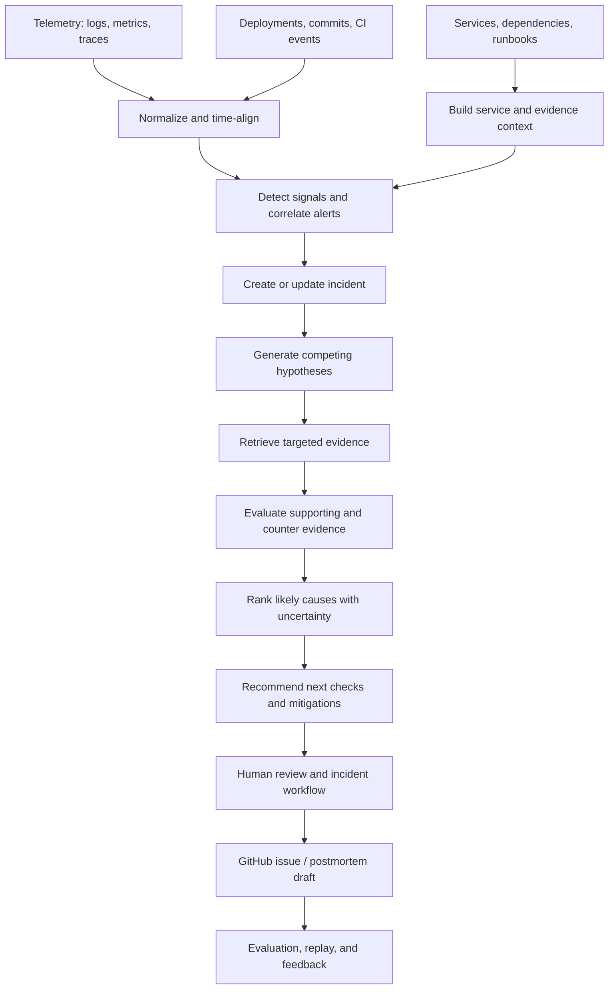

# CloudOps AI
### Evidence-driven incident intelligence for modern software systems

> **Your monitoring tells you something broke. CloudOps AI investigates why.**

CloudOps AI is an open, vendor-neutral incident intelligence platform designed to connect operational signals with the engineering context needed to investigate production failures. The long-term goal is to move beyond noisy alerts and generic log summaries toward **evidence-backed hypotheses, explainable root-cause analysis, and measurable incident investigations**.

**Project status: In development.** This repository is the foundation for the project. Capabilities described as planned below are product goals, not claims that they are already implemented.

---

## The problem

Production incidents rarely announce their cause clearly. A latency spike may be a symptom of a slow dependency; an error burst may begin shortly after a deployment; several alerts may all describe one underlying failure.

Teams often have to correlate logs, traces, deployments, commits, service dependencies, runbooks, and past incidents manually. CloudOps AI is being designed to bring those sources together into a traceable investigation workflow.

## Product thesis

Build an **open, vendor-neutral investigation layer** that assembles operational evidence, generates competing failure hypotheses, tests them against available signals, and presents findings with supporting evidence and counter-evidence.

The differentiator is not “send logs to an LLM.” It is the investigation discipline around the model:

- **Correlate before summarizing:** group related signals into a coherent incident instead of treating every alert as a separate event.
- **Investigate with evidence:** link conclusions to time-bounded logs, traces, deployment events, commits, service relationships, and runbooks.
- **Compare hypotheses:** make uncertainty visible, consider alternative explanations, and avoid presenting an unverified guess as a confirmed root cause.
- **Evaluate rather than merely demo:** test against reproducible scenarios and ground-truth causes, tracking both accuracy and operational cost.
- **Keep humans in control:** recommend mitigations and create engineering artifacts with reviewable evidence; high-impact remediation should require explicit approval.

## Intended investigation workflow



*This is the target architecture. Components will be implemented and validated incrementally.*

## Core product areas

### 1. Telemetry ingestion and normalization
Planned integration path for structured logs and OpenTelemetry signals, with normalized timestamps, service identity, severity, environment, trace/correlation identifiers, and source metadata. Ingestion should validate payloads, handle retries safely, and make duplicate delivery explicit.

### 2. Incident correlation
Reduce alert noise by grouping related events using time windows, service context, trace relationships, error fingerprints, and deployment proximity. Correlation should remain inspectable: users need to understand why two signals were grouped together.

### 3. Evidence graph
Connect services and dependencies to telemetry, deployments, code changes, runbooks, and historical incidents. Every investigation should preserve source references and timestamps so a reviewer can move from a conclusion back to the evidence.

### 4. Hypothesis-driven root-cause analysis
Generate multiple plausible explanations, gather focused supporting evidence, search for contradictions, and rank hypotheses. A result should distinguish:
- observed facts from model-generated interpretation;
- supporting evidence from counter-evidence;
- likely cause from confirmed cause;
- confidence from certainty;
- recommended diagnostics from actions already executed.

### 5. Incident workspace
Target incident lifecycle:

`detected → triaged → investigating → mitigating → resolved → reviewed`

The planned workspace includes an incident timeline, related signals, evidence, hypotheses, investigation notes, ownership, status transitions, and an auditable history.

### 6. Engineering workflow integration
Planned GitHub integration can turn a reviewed incident into a structured issue containing a concise summary, impact, timeline, probable cause, evidence links, relevant deployments/commits, and next steps. Integrations should be idempotent and must not silently create duplicate issues.

### 7. Replay and evaluation lab
Reproducible scenarios will make quality measurable instead of relying on impressive-looking screenshots. The evaluation harness is intended to measure root-cause ranking, evidence quality, alert grouping, latency, and per-investigation cost against labelled incidents.

### 8. Safe-by-default operations
Initial versions should focus on read-only investigation and recommendations. Any future write operation or remediation must use explicit authorization, least privilege, audit events, idempotency where applicable, and human approval for high-impact actions.

---

## Engineering principles

1. **Evidence before assertion.** A root-cause statement should reference the observations that support it.
2. **Temporal correctness.** Replay evaluations must only expose information that would have been available at the simulated investigation time; future-data leakage invalidates the result.
3. **Honest uncertainty.** Missing telemetry, ambiguous evidence, and conflicting hypotheses should be surfaced, not hidden behind a confident-sounding answer.
4. **Deterministic core, probabilistic assistance.** Parsing, access control, incident state transitions, deduplication rules, and evaluation metrics should be testable without depending on an LLM response.
5. **Provider neutrality.** Keep model access behind an interface so the investigation workflow is not coupled to one LLM provider.
6. **Privacy and tenant isolation.** Treat logs and traces as potentially sensitive; minimize stored data, redact secrets, scope every query to the correct tenant, and avoid logging credentials or raw sensitive payloads.
7. **Operational resilience.** Use bounded retries, timeouts, backpressure, idempotent event handling, and observable failure paths.

## Target architecture and technology direction

The planned stack is intentionally pragmatic and may evolve as implementation and measurements demand it.

| Layer | Intended direction | Responsibility |
|---|---|---|
| Web application | Next.js + TypeScript | Incident workspace, timelines, evidence and evaluation views |
| API and domain logic | Python + FastAPI | Ingestion endpoints, incident lifecycle, investigation orchestration |
| Transactional store | PostgreSQL | Tenants, services, incidents, relationships, audit events and configuration |
| Background work | Redis-backed queue or equivalent | Async ingestion, correlation, investigation jobs and retries |
| Observability input | OpenTelemetry-compatible adapters | Standardized traces, metrics and logs |
| AI interface | Provider-agnostic model adapter | Hypothesis generation, evidence synthesis and structured outputs |
| Integrations | GitHub first; webhooks later | Engineering workflow and event delivery |
| Delivery | Docker; CI with GitHub Actions | Reproducible development, automated checks and deployment pipeline |
| Cloud hosting | AWS as an initial deployment target | Runtime, managed storage, secrets and telemetry |

These are architectural targets, not a statement that every component is currently present or deployed.

## Evaluation: how quality should be demonstrated

CloudOps AI should publish results only after running a versioned, reproducible evaluation. The planned benchmark will contain seeded incidents such as a faulty deployment, dependency timeout, resource saturation, configuration drift, and a downstream service failure.

| Metric | What it should answer |
|---|---|
| Root-cause Top-1 accuracy | Was the highest-ranked cause correct? |
| Root-cause Top-3 recall | Did the correct cause appear among the leading hypotheses? |
| Evidence precision | Were cited observations genuinely relevant to the claim? |
| Evidence coverage | Did the investigation include the important available evidence? |
| Alert grouping quality | Were related alerts merged without over-collapsing unrelated failures? |
| Time to useful diagnosis | How long from incident start until a useful, evidence-backed result? |
| False-positive rate | How often did the system declare an incident without sufficient signal? |
| Latency and cost per investigation | Is the workflow practical to operate? |

**No benchmark scores are claimed yet.** Any published result should include the dataset/scenario version, baseline, number of trials, evaluation procedure, and known limitations. Comparisons must use the same inputs and avoid leaking ground truth into the investigation.

## Development roadmap

### Phase 0 — Specification and foundation
- [ ] Define domain models, event contracts, and incident lifecycle.
- [ ] Create the application skeleton, configuration management, and local development environment.
- [ ] Add linting, type checks, unit tests, and CI.
- [ ] Document threat model, data boundaries, and non-goals.

### Phase 1 — First vertical slice
- [ ] Accept a normalized event through an authenticated API.
- [ ] Persist events and create an incident from a seeded failure.
- [ ] Show incident details and an ordered timeline in the UI.
- [ ] Add fixture-driven tests for event validation and incident transitions.

### Phase 2 — Correlation and evidence
- [ ] Deduplicate repeated events with explicit, testable rules.
- [ ] Ingest deployment and GitHub metadata.
- [ ] Link evidence to services, timestamps, and incident hypotheses.
- [ ] Add explainable correlation reasons and counter-evidence.

### Phase 3 — AI-assisted investigation
- [ ] Add a provider adapter and schema-validated outputs.
- [ ] Implement competing hypotheses and targeted evidence retrieval.
- [ ] Separate facts, inferences, uncertainty, and proposed next checks.
- [ ] Test malformed model output, timeouts, retries, and provider unavailability.

### Phase 4 — Replay, integrations, and hardening
- [ ] Build seeded incidents with known causes.
- [ ] Add temporal replay and ground-truth evaluation.
- [ ] Generate reviewed GitHub issues idempotently.
- [ ] Add tenant isolation tests, rate limits, audit coverage, and security checks.
- [ ] Publish reproducible evaluation results and a demo walkthrough.

Roadmap checkboxes should be updated only after each item is implemented and tested.

## Local development

The repository is currently at the **project-foundation stage**. A runnable local environment, service commands, and setup instructions will be added with the initial application skeleton. Until then, the architecture and roadmap above describe the intended direction rather than a working installation.

The planned developer experience is:

1. Clone the repository.
2. Configure local environment variables using a documented `.env.example` with placeholders only.
3. Start dependencies using Docker Compose.
4. Run database migrations and seed reproducible sample services/events.
5. Run tests and start the API and web application.
6. Trigger a seeded failure and inspect the resulting evidence-backed incident.

Never commit API keys, provider credentials, production logs, customer telemetry, or real secrets.

## Security and privacy

The project is being designed for operational data, which can contain secrets, personal information, internal hostnames, and customer identifiers. Before production use, the implementation must include:

- authentication and authorization with tenant-scoped access checks;
- secret redaction and configurable retention;
- TLS for network traffic and secure secret storage;
- input validation, request-size limits, rate limits, and safe error handling;
- audit trails for state changes and external side effects;
- least-privilege integration credentials;
- explicit approval for high-impact actions;
- documented handling for model-provider data retention and telemetry sent to external services.

This repository should not be connected to production systems until these controls have been implemented and reviewed.

## Repository structure (target)

```text
cloudops-ai/
├── apps/
│   ├── api/                 # FastAPI application
│   └── web/                 # Next.js incident workspace
├── packages/
│   └── contracts/           # Shared event and API contracts
├── services/
│   ├── ingestion/           # Validation and normalization
│   ├── correlation/         # Event grouping and incident detection
│   ├── investigation/       # Evidence retrieval and hypothesis evaluation
│   └── integrations/        # GitHub and webhook adapters
├── evals/
│   ├── scenarios/           # Seeded incidents and ground truth
│   └── reports/             # Versioned, reproducible evaluation outputs
├── infra/                   # Local and deployment configuration
├── docs/
│   ├── architecture.md
│   ├── threat-model.md
│   └── decisions/            # Architecture decision records
├── tests/
├── docker-compose.yml
├── .env.example
└── README.md
```

This is a proposed structure and will be adjusted to match the code as the project is built.

## Contributing

Early contributions and design feedback are welcome. Before opening a pull request:

- explain the problem and intended behavior;
- include tests for logic and failure paths;
- document any changes to event contracts or APIs;
- avoid adding secrets, private telemetry, or customer data;
- include reproducible evidence for performance or accuracy claims.

## Current status

CloudOps AI is an early-stage project whose immediate goal is to establish a reliable, testable vertical slice: **ingest an event → correlate a failure → create an incident → show its evidence → evaluate the result**. AI investigation, integrations, and broader cloud deployment will follow this foundation.

Progress should be judged by working code, automated tests, reproducible evaluations, and a usable demonstration—not the number of technologies listed.

## License

A license has not yet been selected. Until one is added to the repository, no open-source license should be assumed.
